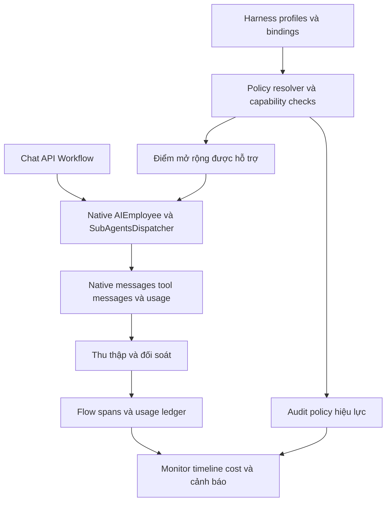

# Kế hoạch Harness và Agent Flow Monitor

Trạng thái: kế hoạch định hướng; các sửa đổi đang thực hiện được ghi riêng bên dưới. Ngày: 2026-11-10.

### Ghi nhận triển khai 2026-11-10

- Observer native chuyển sang quan sát best-effort, không sửa task/prompt, binding, output hoặc lỗi của core. Monitor bổ sung đồng bộ phân trang theo record đã lưu; mỗi vòng đầy đủ cần chạy lại để thu thập record đến muộn hoặc cập nhật record cũ. Root đại diện session, không phải từng request; chưa khẳng định realtime hoặc coverage đầy đủ.
- Usage model call lấy từ native usage event khi có, dùng identity để chống ghi trùng và lưu snapshot giá được cấu hình; không có số token hoặc giá thì báo thiếu/chưa định giá. Chi phí này không phải dữ liệu thanh toán provider.
- Đồng bộ trace và cleanup dùng chung khoảng retention toàn cục theo thời điểm hoạt động native, có fallback cho span cũ chưa có trường hoạt động. Ledger model call giữ riêng để bảo toàn usage/giá lịch sử; retention trace không xóa ledger hay dữ liệu thuộc core.
- Matrix capability đánh dấu giới hạn thực thi theo từng đường và không quảng bá harness native chưa có extension contract là chốt bắt buộc. Lifecycle API riêng chỉ thu thập best-effort; không phải hook chung của core.
- Legacy loop/scheduler và dữ liệu được giữ để tương thích; chưa inventory, drain hay cutover P5. Bucket ngân sách ngày/toàn cục của legacy loop ghi reservation, chưa đối soát đầy đủ chi phí model call native thực tế; không coi đó là trần chi tiêu thực tế được đảm bảo.
- Các cổng P0–P6 trong tài liệu vẫn là tiêu chí đích, không mặc định đã hoàn tất. Kiểm thử tích hợp, build/pack và giới hạn xác minh được báo trong kết quả phiên làm việc.

Phạm vi là `plugin-agent-orchestrator` trong fork `OrgGem/nocobase-beta`, baseline `ef97a486a6`, cùng các bản sửa chưa commit của phiên review trước. Core `@nocobase/plugin-ai` tiếp tục sở hữu vòng lặp agent, điều phối sub-agent, checkpoint, approval, retry và resume. Plugin tập trung vào harness có thể áp dụng qua điểm mở rộng được hỗ trợ, theo dõi luồng thực thi, token và chi phí.

## 1. Quyết định phạm vi

- Giữ và phát triển profile harness có version, cấu hình hiệu lực theo employee, kiểm tra khả năng thực thi và audit quyết định policy.
- Giữ và phát triển monitoring cho main agent, sub-agent, model call, tool call và liên kết skill execution.
- Lấy usage thực tế của core/provider làm nguồn chính. Chi phí tính theo bảng giá có version; không gọi chi phí ước tính là hóa đơn thực tế.
- Không phát triển một agent runtime khác: không thêm leader–maker–verifier, pattern scheduler, worktree coordinator hay approval engine riêng.
- Không sửa `packages/core/**` hoặc `packages/plugins/@nocobase*/**` trong delivery này. Nếu thiếu điểm mở rộng, ghi nhận capability chưa hỗ trợ và tách đề xuất core thành công việc riêng.
- Không đổi tên package, xóa dữ liệu lịch sử hoặc tách Skill Hub sang package khác trong đợt đầu.

Harness và monitoring có hợp đồng khác nhau. Monitoring không được sửa prompt, tool binding, kết quả hoặc quyết định của core; lỗi telemetry không được làm agent thất bại. Harness có thể thay đổi hành vi theo policy quản trị viên đã chọn, nhưng chỉ ở đường thực thi đã được kiểm chứng. Policy bắt buộc không được âm thầm hạ thành cảnh báo.

## 2. Hiện trạng ban đầu và bằng chứng trong source

| Thành phần | Hiện trạng | Hệ quả đối với thiết kế |
| --- | --- | --- |
| Native runtime | [AIEmployee](../../@nocobase/plugin-ai/src/server/ai-employees/ai-employee.ts) tạo agent, checkpoint và xử lý interrupt/resume; [dispatcher](../../@nocobase/plugin-ai/src/server/ai-employees/sub-agents/dispatcher.ts) chạy sub-agent | Tái sử dụng lifecycle native; không lập lịch chạy agent lần thứ hai |
| Tool extension | [ToolsRegistration](../../../core/ai/src/tools-manager/types.ts) có `registerTools` và `registerDynamicTools` | Có thể mở rộng tool do plugin quản lý; API này không chứng minh có global interceptor cho mọi tool |
| Agent middleware | `AIEmployee.getMiddleware()` là private; các đường chat/workflow/sub-agent trực tiếp `new AIEmployee` | Chưa thấy registry middleware hoặc injectable factory chung; không coi export class/public method là extension contract |
| Native observer | Trước sửa đổi, [NativeSubAgentObserver](../src/server/services/NativeSubAgentObserver.ts) thay `dispatcher.run`, sửa `skillSettings`, chèn memory, giới hạn delegation và có thể thay kết quả. Wrapper hiện tại chuyển sang quan sát best-effort | Wrapper vẫn phụ thuộc nội bộ và cần kiểm chứng parity; không coi là extension contract để thực thi policy |
| Lifecycle custom | [AgentRuntimeLifecycle](../src/server/services/AgentRuntimeLifecycle.ts) do plugin cung cấp; [API route](../../plugin-ai-api/src/server/routes/agent-completions.ts) gọi hooks và [user-memory](../../plugin-user-memory/src/server/plugin.ts) đăng ký hooks | Giữ compatibility cho các consumer; không quảng bá là lifecycle chung của core. Hooks hiện nuốt lỗi nên không dùng trực tiếp làm chốt policy bắt buộc |
| Native usage | [convertAIMessage](../../@nocobase/plugin-ai/src/server/ai-employees/utils.ts) giữ model, provider, llmService, usage và response metadata | Có nguồn thực tế để thay ước lượng từ độ dài văn bản, tùy provider có trả usage hay không |
| Thu thập thay đổi | [Conversation middleware](../../@nocobase/plugin-ai/src/server/ai-employees/middleware/conversation.ts) lưu message; `AIEmployee` cũng gọi trực tiếp model update | Phải thử coverage của collection/model hooks; thêm đối soát incremental cho dữ liệu đã commit nếu hook không đủ |
| Usage | Trước sửa đổi, [TokenTracker](../src/server/services/TokenTracker.ts) dùng giá input/output chung và observer ước lượng từ text. Phần đang triển khai lấy usage event, lưu snapshot giá cấu hình và phân biệt dữ liệu thiếu | Vẫn cần kiểm chứng integration/coverage; không xem giá cấu hình là hóa đơn provider |
| UI hiện tại | [AgentRunsTab v2](../src/client-v2/components/AgentRunsTab.tsx) gọi `agentMonitor`; [TracingTab](../src/client-v2/components/TracingTab.tsx) hiển thị trace | Mở rộng UI hiện có cho native flow; không thêm console cho control plane riêng |
| Phụ thuộc Skill Hub | [Registry bridge](../../plugin-skill-registry/src/server/services/agent-installation-bridge.ts) và [provider](../../plugin-skill-registry/src/server/providers/skill-hub-provider.ts) tìm plugin orchestrator | Giữ facade và API đang dùng, hoãn extraction thành plugin riêng |

Các nhận định lịch sử và thay đổi được phân biệt ở bảng trên. Mức bao phủ runtime của từng adapter sẽ được xác nhận bằng các cổng kiểm thử ở phần 8; không suy ra từ việc class hoặc method tồn tại.

## 3. Kiến trúc đích

Đường harness chỉ có hiệu lực trên adapter đã được kiểm chứng. Đường monitoring đọc hoặc sao chiếu dữ liệu native; không ghi đè native message, checkpoint hay approval.

### 3.1 Capability theo từng đường chạy

Lập ma trận cho `chat`, `api`, `workflow`, `sub-agent`, đồng thời phân biệt stream, non-stream và resume. Mỗi policy có một trong ba trạng thái:

| Trạng thái | Ý nghĩa | Hành vi quản trị |
| --- | --- | --- |
| Enforced | Có chốt thực thi trước tác động và test runtime chứng minh phạm vi đó | Cho phép chọn bắt buộc trong đúng phạm vi |
| Observe only | Quan sát hoặc cảnh báo được, chưa bảo đảm ngăn hành động | Hiển thị rõ là giám sát; không gọi là giới hạn cứng |
| Unsupported | Không có đường tích hợp đủ tin cậy | Không cho áp dụng như policy bắt buộc; trả lý do cụ thể |

Capability bao gồm phiên bản core, adapter, phạm vi và giới hạn. Nếu core nâng cấp làm mất capability, policy bắt buộc phải bị từ chối tại chốt đã xác định trước khi chạy; nếu không có chốt đó thì không được cung cấp chế độ bắt buộc từ đầu. Không để việc kiểm tra thất bại chỉ tạo warning rồi agent tiếp tục với quyền rộng hơn.

### 3.2 Phạm vi harness ban đầu

| Nhóm policy | Thiết kế | Điều kiện triển khai |
| --- | --- | --- |
| Capture, redaction, retention | Thực thi trên dữ liệu plugin lưu và trả về; không sửa dữ liệu native | Kiểm tra ACL, cả input/output và metadata, thời hạn lưu theo profile |
| Tool allow/ask/deny | Ánh xạ vào native binding/approval hoặc kiểm soát tool thuộc plugin | Phải chứng minh đường gọi thực tế; giữ ACL core, không tự thêm quyền; `ask` dùng approval native |
| Token và cost | Tổng hợp usage, cảnh báo theo ngưỡng; admission check chỉ trong đường hỗ trợ | Không hứa trần chi phí tuyệt đối cho lời gọi đang chạy hoặc khi provider không trả usage |
| Timeout và output size | Thực thi cho tool do plugin sở hữu nếu có hủy/giới hạn thực sự | Tool core/MCP khác chỉ giám sát khi chưa có hook phù hợp |
| Delegation, recursion, memory/context | Giữ cấu hình có giá trị, nhưng chỉ kích hoạt qua extension contract xác nhận được | Không dùng prompt injection hoặc thay `dispatcher.run` làm bằng chứng hỗ trợ chính thức |
| Worktree và network isolation | Ngoài phạm vi đợt này | Ẩn hoặc đánh dấu legacy/unsupported; không hiển thị như bảo vệ đã có |

Giữ draft/publish và version bất biến của [HarnessProfileService](../src/server/services/HarnessProfileService.ts). Binding tối thiểu gồm default và employee; không thêm hệ phân quyền theo team/role mới nếu chưa có nhu cầu. Policy chỉ thu hẹp quyền hiện hữu của core.

Khi adapter hỗ trợ context cho từng invocation, ghi snapshot/version hiệu lực và quyết định theo invocation. Khi chỉ đồng bộ cấu hình employee được, hiển thị là cấu hình persistent áp dụng cho các lần đọc tiếp theo; không tuyên bố đã đóng băng policy cho cả session/resume. Không thay đổi employee model dùng chung để giả lập policy riêng từng request.

## 4. Thiết kế monitoring và usage

### 4.1 Cây thực thi và định danh

Tách conversation dài hạn khỏi một lượt yêu cầu. Một lượt có main-agent span, các model-call/tool-call và sub-agent con; invocation tiếp tục sau approval liên kết với lượt cũ, còn retry thực sự có attempt riêng.

- Tái sử dụng `sessionId`, native message identity, provider message/request identity, `toolCallId` và metadata sub-agent để tạo khóa ổn định.
- Chứng minh tính duy nhất và hành vi khi regenerate/resume trước khi chốt unique index. Nếu native thiếu identity cần thiết, đánh dấu correlation chưa đầy đủ, không ghép bằng thời gian rồi coi là chắc chắn.
- Mọi nguồn live/sync/backfill đi qua cùng logic upsert idempotent. Sự kiện đến muộn không được đổi một execution đã kết thúc thành đang chạy.
- Độ sâu và tổng thời gian lấy từ cây lời gọi; không cộng thời lượng các nhánh chạy song song để giả làm wall-clock của cha.
- Trạng thái mục tiêu: running, waiting approval, completed, failed, canceled, unknown/incomplete. Chỉ ghi timeout khi có bằng chứng timeout.
- Hiển thị coverage và độ trễ đồng bộ. Native record bị xóa/regenerate không được âm thầm làm mất usage đã thực sự phát sinh.

### 4.2 Nguồn thu thập

Ưu tiên dữ liệu đã commit trong `aiConversations`, `aiMessages`, `aiToolMessages` và extension events được xác minh. Thử collection/model hooks trên các đường write thật; không giả định repository hooks bao phủ các lệnh model update trực tiếp.

Đối soát dùng cursor, giới hạn batch và cơ chế tiếp tục sau restart. Xác minh khả năng phát hiện cập nhật của record cũ: nếu schema không có cursor thay đổi tin cậy, dùng cửa sổ overlap có giới hạn và rà lại các session còn active. Cursor chỉ dựa vào ID tăng dần không đủ cho approval/resume cập nhật row cũ. Backfill không chạy quét toàn bộ database trên mỗi request UI.

Thu thập metadata không được rollback transaction nghiệp vụ khi telemetry lỗi. Tách xử lý sau commit, giữ cơ chế đối soát bù và đo độ trễ/mất dữ liệu. Wrapper nội bộ hiện tại chỉ là compatibility tạm thời, không mở rộng thêm; chuyển khỏi wrapper khi nguồn mới đạt parity trong các tình huống đã xác định.

### 4.3 Usage và cost

Đề xuất ledger usage riêng thay vì cộng số liệu trực tiếp trên span cha. `agentExecutionSpans` tiếp tục là projection cho UI. Tên collection mới được chốt ở P2; tối thiểu ledger cần:

| Nhóm dữ liệu | Nội dung |
| --- | --- |
| Identity | Application scope, native invocation/attempt/message key, session, employee, user, model, provider, llmService |
| Usage | Input/output/total và cached/reasoning token nếu provider có trả; nguồn actual/estimated/missing |
| Giá | Currency, price version, giá input/output/cache thích hợp, thời điểm hiệu lực |
| Chất lượng dữ liệu | Coverage, trạng thái partial/final, thời điểm thu thập và native identity để đối soát |

Quy tắc tính:

1. Chỉ cộng usage riêng của model call vào tổng. Usage bao gồm con của agent span chỉ là giá trị tổng hợp, không cộng lần nữa.
2. Chuẩn hóa cached/reasoning token theo provider vì chúng có thể là phần con của input/output; không cộng mù vào total.
3. Event lặp hoặc resume trả lại lịch sử không làm phát sinh usage lần hai. Retry có lời gọi model mới vẫn được tính, kể cả attempt thất bại.
4. Usage thực tế thay thế estimate của cùng identity, không cộng chồng. Không có usage thì ghi missing, không mặc định bằng 0.
5. Snapshot giá tại lúc ghi nhận; cập nhật bảng giá không tự thay chi phí lịch sử. Định giá lại phải là thao tác riêng có audit.
6. Nếu thiếu giá model, vẫn báo token và chi phí chưa định giá. Chi phí chỉ trở thành số liệu thanh toán thực tế khi có nguồn billing tương ứng; đợt này chưa tích hợp billing API.
7. Với call thất bại trước khi lưu native message, nếu không có usage thì báo coverage thiếu; không tuyên bố số liệu bằng hóa đơn provider.

Thống kê theo thời gian, employee, user, model/provider và lượt yêu cầu. Cảnh báo ngưỡng cần chống lặp; MVP hiển thị trong ứng dụng, chưa tích hợp gửi email/Slack.

### 4.4 API và UI

- Mở rộng `agentMonitor`/`orchestratorTracing` để hỗ trợ main-agent roots và cây đầy đủ, giữ response cũ cho consumer hiện có bằng bổ sung tương thích hoặc endpoint phiên bản mới.
- Thêm resource chỉ đọc cho usage/cost tổng hợp; tách quyền xem tổng hợp, xem nội dung nhạy cảm, quản lý harness và bảng giá.
- Harness UI hiển thị policy hiệu lực, nguồn từng lớp, version và capability theo đường chạy. Cho xem trước ảnh hưởng trước khi apply binding.
- Monitor UI có danh sách lượt chạy, cây gọi, timeline, lỗi và trạng thái native approval. Không thêm nút thao tác riêng nếu chưa ánh xạ được sang API native có ACL và audit.
- Không dùng link sang native conversation như cách vượt quyền: cả detail và linked resource đều phải kiểm tra quyền server-side.
- V2 chỉ dùng `@nocobase/client-v2`; V1 có thể reuse V2 theo quy tắc repo. Nhãn mới dùng i18n, có `en-US` và `zh-CN`, theo Ant Design v5 và a11y.

## 5. Thành phần giữ lại và thành phần chuyển đổi

| Thành phần hiện tại | Hướng xử lý |
| --- | --- |
| HarnessSchema, HarnessCompiler, HarnessProfileService, profile UI | Giữ; kiểm tra semantics của lớp không cấu hình, inheritance và hỗ trợ thực thi |
| NativeSubAgentObserver | Tách telemetry khỏi mutation/policy; thay wrapper bằng nguồn dữ liệu được chứng minh đủ coverage |
| ExecutionSpanService, AgentExecutionContext, agentMonitor, tracing | Giữ; mở rộng identity/correlation, main-agent coverage và read ACL |
| TokenTracker | Chuyển trách nhiệm tổng hợp/định giá sang usage ledger; giữ facade trong thời gian consumer còn dùng |
| AgentRuntimeLifecycle | Giữ hợp đồng cho API/user-memory; ghi rõ source coverage và semantics best-effort; không coi là policy gate |
| Skill Hub và registry bridge | Giữ hoạt động và public API; ghi link execution vào trace, chưa tách package |
| Memory/RAG context extensions | Giữ compatibility với consumer đã bật; đưa can thiệp ra khỏi observer và chỉ hỗ trợ qua đường extension hợp lệ |
| LoopWorker/Scheduler, patterns, verifier, loop approvals | Ngừng mở rộng; chuyển sang legacy read-only sau bước drain có kiểm soát |
| Historical loop collections | Giữ để tra cứu; không drop hay đổi nghĩa ID trong migration |

## 6. Các giai đoạn triển khai

| Giai đoạn | Công việc và file chính | Điều kiện hoàn tất |
| --- | --- | --- |
| P0 Xác minh tích hợp | Contract tests native chat/API/workflow/sub-agent; kiểm kê consumers; kiểm tra hook coverage và dữ liệu usage. Đọc core, chỉ sửa test/custom plugin khi triển khai | Có ma trận capability có bằng chứng, mẫu identity/usage cho stream và resume; không còn giả định global middleware hook |
| P1 Nền tảng monitor | Tách NativeSubAgentObserver, sửa ExecutionSpanService và resource monitor/tracing; thêm ingest idempotent và incremental reconciliation | Main agent không delegate vẫn xuất hiện; nested/parallel/approval/resume/restart không nhân bản span; monitoring không thay hành vi native |
| P2 Usage và cost | Thiết kế ledger, bảng giá versioned, migration/backfill có giới hạn, thay TokenTracker qua facade | Fixture usage xác định trước ra đúng tổng; chống double-count, thay estimate bằng actual và giữ giá lịch sử |
| P3 Harness theo capability | Resolver cho default/employee, capability validation, decision audit, adapter cho các điểm mở rộng đã xác nhận; giữ profile versioning | Policy bắt buộc chưa hỗ trợ bị từ chối; policy hỗ trợ áp dụng đúng phạm vi và không tăng quyền; approval theo native |
| P4 UI quản trị | Cập nhật V1/V2 monitor, detail tree, usage dashboard, capability/effective harness view, ACL/i18n | Quản trị viên truy được từ tổng cost tới model call, hiểu nguồn số liệu và policy; không nhầm thiếu dữ liệu với 0 |
| P5 Chuyển đổi legacy | Inventory run/schedule/approval đang mở; tắt nhận việc cũ có kiểm soát, drain, giữ archive và compatibility API | Không còn worker/scheduler riêng được khởi động cho cấu hình đã cutover; dữ liệu và consumer cũ còn đọc được |
| P6 Kiểm chứng phát hành | HTTP integration, browser E2E, migration/rollback, focused typecheck/lint, native build và pack | Đạt toàn bộ gate phát hành; báo riêng phần chưa được runtime hoặc clean-install xác nhận |

Thứ tự phụ thuộc: `P0 → P1 → P2`; `P3` bắt đầu sau khi P0 xác nhận các chốt thực thi và dùng nền tảng audit của P1. `P4` cần hợp đồng P1/P2/P3. Chỉ làm P5 sau khi đường monitor/harness thay thế đạt coverage đã thống nhất. P6 là gate cuối, không thay thế test trong từng PR.

Tách delivery theo các giai đoạn trên để mỗi PR có thể review và rollback. Không gom thay đổi schema, thay observer, xóa control plane và chỉnh UI vào một PR. Không ước lượng lịch cố định trước P0 vì thiếu global runtime hook có thể làm đổi giải pháp harness.

## 7. Chuyển đổi và rollback

1. Giữ nguyên các bản sửa review chưa commit và test của chúng; không revert khi thu gọn scope. Lập danh sách tác động của deprecation trước khi đổi hành vi.
2. Schema theo hướng bổ sung. Collection/field mới có thể sync theo cơ chế NocoBase; thay đổi field/index hiện hữu và backfill cần migration idempotent theo quy tắc repo. Không sửa core schema.
3. Chạy ingest mới với dữ liệu thử và đối soát với nguồn native. Nếu cần chạy song song adapter cũ/mới, chỉ một đường được ghi vào projection dùng cho báo cáo; dùng khóa idempotency chung để ngăn double-count.
4. Với installation có legacy runs, ngừng nhận run mới theo bước cutover được quản trị viên chủ động thực hiện. Cho tác vụ đang chạy kết thúc; `waiting_approval`, `waiting_human` và paused phải được giải quyết hoặc có lựa chọn xử lý rõ ràng. Không tự cancel, tự approve hay xóa chúng.
5. Fresh install dùng phạm vi native monitor/harness. Upgrade chưa hoàn tất drain giữ compatibility có giới hạn và báo legacy đang hoạt động; không âm thầm bật scheduler ở installation đã cutover.
6. Snapshot/version của harness, usage ledger và lịch sử trace còn đọc được sau rollback phần UI/adapter. Không rollback dữ liệu bằng drop table. Kiểm tra backward-read với bản hỗ trợ rollback trước khi phát hành.
7. Xóa hẳn code/collection legacy là delivery riêng sau khi không còn consumer và run cần xử lý, không thuộc kế hoạch triển khai đầu tiên.

## 8. Kiểm thử và tiêu chí nghiệm thu

### Contract và runtime

- Chat stream/non-stream, API stream/non-stream, workflow và sub-agent; main-only, nested và parallel calls.
- Tool thành công/thất bại, model thất bại trước/sau usage, cancel, native approval approve/edit/reject, resume và retry.
- Monitoring bật/tắt cho cùng đầu vào: cùng prompt, tool settings, kết quả và hành vi điều phối; chỉ telemetry thay đổi. Lỗi DB telemetry không làm hỏng native call.
- Harness bật có thay đổi hành vi đúng policy đã chọn; policy bắt buộc không được nuốt lỗi như lifecycle best-effort.
- Một user không được đọc trace, native message, usage chi tiết hoặc nội dung tool của user khác qua filter, ID, relation hay link detail. Test qua HTTP/resource middleware thật, không chỉ gọi handler trực tiếp.

### Dữ liệu và vận hành

- Event trùng, cập nhật out-of-order, resume dùng lại lịch sử, regenerate/xóa native message, backfill lặp, restart giữa batch và hai instance ingest cùng một call.
- Parent/child không double-count; retry phát sinh call mới được tính; cached/reasoning token không cộng sai; missing usage và missing price hiển thị đúng.
- Retention không xóa nguồn cần để đối soát trước khi chốt usage; capture/redaction tuân thủ profile và quyền xem. Kiểm tra cả free text vì scrub theo tên key không đủ bảo đảm che mọi bí mật.
- Đo overhead p50/p95 bằng workload mẫu cố định ở P0; dùng batch/cursor để giới hạn bộ nhớ và backlog. Chốt ngưỡng chấp nhận từ baseline thay vì hứa một con số chưa đo.
- Migration chạy lại không nhân bản dữ liệu; drain không làm mất approvals; rollback giữ được lịch sử.

### Lệnh và phạm vi bằng chứng

- Chạy server tests tuần tự bằng `yarn test <path> --run --maxWorkers=1 --minWorkers=1 --no-file-parallelism`.
- Chạy `yarn eslint --fix` trên file đã sửa, focused semantic diagnostics và `git diff --check`; không sửa lỗi bằng tắt lint hoặc thêm `any`.
- Trước gate integration, chuẩn bị test database riêng. Môi trường phiên trước thiếu `sqlite3`; không coi smoke đạt hoặc tự chuyển sang database nghiệp vụ.
- Build bằng PowerShell từ repo root: `yarn nocobase build plugin-agent-orchestrator --no-dts`. Chỉ `npm pack` sau build thành công và kiểm tra client/server/locales/externalVersion cùng client-v2 bundle cần thiết.
- Build/pack, unit tests, HTTP integration, browser E2E và deployment là các bằng chứng khác nhau. Không suy từ bước trước sang bước sau.

## 9. Những quyết định phải đóng ở P0

| Câu hỏi | Mặc định trong kế hoạch |
| --- | --- |
| Core có extension runtime khác chưa được phát hiện không? | Chỉ công nhận sau contract test; không dựa vào monkey-patch/prototype override |
| Có thể thu toàn bộ usage từ native persistence không? | Công bố coverage; phần thiếu giữ unknown/estimated, không giả làm actual |
| Có thể đóng băng harness theo invocation khi resume không? | Chỉ hứa snapshot enforcement khi adapter chứng minh được; nếu không, ghi phạm vi cấu hình persistent |
| Tool deny/ask có bao phủ tool core, workflow và MCP không? | Kiểm tra riêng từng nguồn; không áp dụng kết luận của tool Skill Hub cho toàn hệ thống |
| Có cần thay đổi core để enforce policy chung không? | Tách RFC/PR core riêng, ngoài phạm vi được phép hiện tại; monitoring và harness được hỗ trợ vẫn triển khai được |
| Có legacy execution đang dùng không? | Inventory trước cutover; không suy từ source rằng deployment không có run đang mở |

Kết quả đợt triển khai đầu tiên phải là một plugin quản trị giúp nhìn rõ native agent flow và chi phí, đồng thời chỉ cung cấp harness enforcement ở nơi có hợp đồng tích hợp và bằng chứng kiểm thử. Các khả năng chưa hỗ trợ được thể hiện rõ thay vì bổ sung runtime riêng để thay core.

## 10. Ghi nhận kiểm chứng và artifact

Kết quả này xác nhận một phần triển khai ban đầu, không có nghĩa các giai đoạn P0–P6 đã hoàn tất. Bảng ở mục 2 mô tả source trước đợt sửa; ghi nhận triển khai ở đầu tài liệu mô tả phạm vi hiện tại.

- Trước các chỉnh sửa kiểu/logger cuối, full suite server của plugin chạy tuần tự trong SQLite cô lập: **43 file, 273 test đạt**. Trong đó có 3 test HTTP/resource và 2 test migration tích hợp; đây là tập con của tổng, không cộng thêm.
- Sau các chỉnh sửa kiểu/logger cuối, **27/27 test tập trung** đạt: 16 TokenTracker, 3 native sync và 8 observer.
- Đối chiếu focused TypeScript 5.6.3 với baseline HEAD cho thấy **0 diagnostic mới**, còn **16 diagnostic trùng baseline** trong `plugin.ts`, `LoopRunRepository` và `VerificationService`. Đây không phải typecheck sạch toàn repo; TypeScript 5.1 của repo vẫn gặp lỗi parse dependency `@types/sanitize-html` trong kiểm tra rộng.
- `yarn nocobase build plugin-agent-orchestrator --no-dts` chạy thành công; đã kiểm tra output client, client-v2, server, locale, external version, migration và các module monitor/usage. `npm pack` chạy thành công sau build.
- Artifact: `plugin-agent-orchestrator-1.1.8.tgz`, 1.396.760 byte, SHA-256 `F20B246804AEA1291E7B968EEA2875406B0B8A04CE8999239BA677871035573F`. Danh sách 1.073 entry đã được kiểm tra có bundle, locale, migration và các module cần thiết. Archive là artifact build/pack, không phải bằng chứng đã cài đặt hoặc triển khai.

Chưa xác minh đồng thời trên PostgreSQL, migration/đồng thời trên MySQL, browser E2E, dữ liệu billing thực tế của provider, clean install hoặc production. Chưa thực hiện inventory/drain/cutover legacy; những việc đó và các gate còn lại của mục 6–8 vẫn cần xử lý trước khi tuyên bố hoàn tất phát hành.
