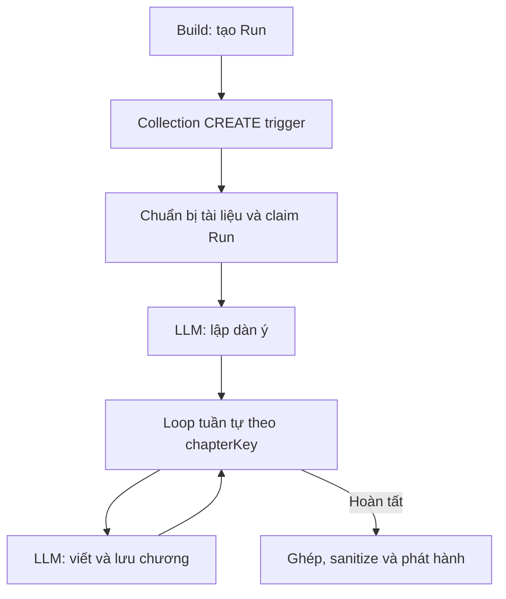

# Kế hoạch chuyển Build Guide sang NocoBase Workflow

Trạng thái: source, kiểm thử, build và pack đã hoàn tất ngày 2026-11-11. Cắt chuyển runtime chưa được thực hiện.

Phạm vi: `plugin-build-guide-block` và plugin mới `plugin-workflow-build-guide` trong fork OrgGem. Các contract được đối chiếu với source/API NocoBase đang có trong checkout trước khi triển khai. Mẫu tham khảo `plugin-git-manager` và `plugin-workflow-git-review` là tài liệu đối chiếu, không được xem là một phần của thay đổi này.

## Trạng thái triển khai

- Giai đoạn 1–4 bên dưới đã được triển khai trong hai plugin; receipt kiểm thử/build/pack và giới hạn kiểm chứng nằm ở [workflow-build-validation.md](workflow-build-validation.md).
- Hướng dẫn cài đặt thử nghiệm, cutover và rollback đã được chuẩn bị trong [workflow-build-operations.md](workflow-build-operations.md). Đây chỉ là tài liệu vận hành: chưa cài plugin, enable plugin, chạy nâng cấp database, đổi worker mode hoặc cutover.
- Các kiểm thử native dùng provider stub và worker queue trong cùng tiến trình `getApp`; chưa kiểm chứng worker `workflow:process` chạy ở tiến trình riêng, provider thật, browser/runtime hoặc môi trường production.
- Các ca cancel/unknown chuyên biệt chưa có hồi quy native tích hợp riêng; xem mục giới hạn trong receipt trước khi phê duyệt cutover.

## 1. Kết quả cần đạt

- Nút Build tạo một lượt chạy có định danh; NocoBase Workflow điều phối các bước đọc tài liệu, lập dàn ý, viết chương và phát hành guide.
- Người vận hành xem được execution, bước đang chạy, số chương hoàn tất và lỗi phù hợp với quyền của mình.
- Tiếp tục được từ chương đã lưu; tránh chạy trùng và ngăn kết quả muộn ghi đè lượt mới.
- Guide đã phát hành tiếp tục hiển thị trong khi rebuild; chỉ thay thế khi bản mới hoàn tất và hợp lệ.
- Giữ `spaceId`, API đọc HTML/Markdown, block User Guide và client v1/v2 hiện có.
- Chuyển đổi có kiểm soát; mỗi run chỉ có một cơ chế thực thi sở hữu.

Ngoài phạm vi: bổ sung chế độ xem guide cho Plugin Settings Embed; sửa allowlist Embed; thay core/base plugin; xây workflow engine/LLM gateway mới; approval; chỉnh graph tự do; tự động publish package hoặc thay cấu hình hạ tầng.

## 2. Quyết định thiết kế

### Phân chia trách nhiệm

| Thành phần | Trách nhiệm |
| --- | --- |
| Build Guide | Dữ liệu Space, Run và kết quả từng bước; kiểm tra quyền; đọc attachment; prompt/validation nghiệp vụ; ghép và sanitize guide; API và UI |
| Workflow Build Guide | Đăng ký instruction và UI cấu hình; template/revision workflow; liên kết Run–execution; checkpoint/resume; reconcile |
| Workflow native | Trigger, execution/job, điều phối graph, Loop và worker `workflow:process` |
| AI native | Cấu hình provider/model và tạo provider; không sao chép kho credential |

Plugin mới phụ thuộc Build Guide, Workflow, Loop và AI theo API thực tế sử dụng. Build Guide không phụ thuộc ngược adapter. Định nghĩa một interface thực thi nhỏ trong Build Guide để adapter đăng ký; không làm registry/abstraction đa engine ngoài hai đường legacy và workflow cần cho cutover.

Giữ engine legacy làm mặc định cho cài đặt cũ. Cài hoặc bật adapter không tự chuyển engine. Một cấu hình engine tường minh là công cụ cutover; không tạo hàng loạt feature flag. Nếu engine được chọn là workflow nhưng dependency/graph không hợp lệ, từ chối tạo run mới với thông báo rõ, không âm thầm fallback sang legacy.

### Graph mặc định

Ba loại instruction dự kiến: `guidePrepare`, `guideLlm` với mode `plan`/`chapter`, và `guidePublish`; dùng Loop native. Tên cuối cùng phải có namespace để tránh xung đột registry. Lưu kết quả là phần hoàn tất của instruction LLM, không thêm node chỉ chuyển trạng thái nếu không có giá trị quan sát riêng.

Chọn instruction LLM mỏng theo mẫu Git Review để bảo đảm checkpoint trước khi gọi và kiểm soát dữ liệu lưu trong job. Tái sử dụng provider native; không giữ queue/consumer riêng để chạy LLM. Native LLM vẫn là nguồn tham khảo và có thể thay thế instruction này nếu test chứng minh đầy đủ hợp đồng persistence, resume và quyền đọc cần thiết.

Template đầu tiên là graph được quản lý. Cho phép chỉnh prompt/model và giới hạn chương qua cấu hình có validation. Mỗi lần thay đổi có hiệu lực tạo revision mới; run giữ revision đã ghim. Trong đợt đầu, chỉ kích hoạt revision mới sau khi ngừng nhận run mới và drain các run của revision cũ, vì native có thể disable revision cùng key trước đó và recovery chỉ tìm workflow đang enabled. Có thể tạo draft trước nhưng không thay revision đang phục vụ khi còn run hoạt động. Không cho chỉnh cấu trúc graph tùy ý trong đợt đầu.

## 3. Hợp đồng dữ liệu và trạng thái

Tên collection dưới đây là đề xuất, phải kiểm tra xung đột trước khi thêm:

- `aiBuildGuideRuns`: chỉ metadata điều phối được phép xuất hiện trong execution context: `spaceId`, `engine`, ID người yêu cầu, revision workflow, `executionId`, trạng thái, thời điểm, mã lỗi an toàn và số chương dự kiến/hoàn tất. Không chứa prompt, nội dung nguồn, output, secret hoặc lỗi provider nguyên bản.
- `aiBuildGuideRunSteps`: run, định danh bước ổn định (`prepare`, `plan`, `chapter:<chapterKey>`, `publish`), attempt/lease token, owner execution/job, trạng thái và tham chiếu kết quả/checkpoint riêng tư. Ràng buộc duy nhất theo run + step key; attempt mới cập nhật quyền sở hữu có điều kiện. Snapshot cấu hình và dữ liệu nghiệp vụ nằm trong artifact/checkpoint được kiểm soát quyền của run, không nằm trong bản ghi kích hoạt collection trigger.
- Space có tham chiếu run đang chạy và run đã phát hành. Giữ các field HTML/Markdown hiện có để tương thích API; không dùng một trạng thái `building` để vô hiệu hóa bản đã phát hành.

Snapshot riêng tư của run lưu cấu hình phi bí mật: prompt/version, model/provider ID, giới hạn chương và định danh tài liệu. Snapshot nội dung nguồn phải ổn định khi attachment bị sửa/xóa, nằm trong storage có kiểm soát truy cập; không chỉ lưu một đường dẫn mutable hoặc hash rồi giả định có thể đọc lại nội dung cũ. Việc đổi/xóa credential có thể làm run thất bại rõ ràng; không chép secret vào snapshot.

Trạng thái run: `queued → running → completed | failed | cancelled | unknown`. `unknown` dùng khi không biết lần gọi provider đã hoàn tất hay chưa; không coi đây là thành công hoặc tự retry vô hạn. Trạng thái bước tương ứng và có thêm `pending` khi đang đợi tác vụ bất đồng bộ. Trạng thái domain và execution native được ánh xạ tường minh, không giả định enum giống nhau.

UI cũ nhận các field trạng thái tương thích; UI mới đọc tiến độ run. Bản ghi legacy có HTML đã hoàn tất vẫn đọc được dù chưa có published run. Backfill không được gọi LLM hoặc làm mất bản đang hiển thị. Kiểm tra toàn bộ reader, gồm SpaceSelect v1/v2 và AI tool `search-guides`, không chỉ `getHtml`: các filter `status=completed` phải phản ánh bản đã phát hành. Chương staging nằm trong artifact của run; chỉ publish mới thay tập page công khai, tránh search/read trộn chương cũ và mới.

Collection/field/index mới theo cơ chế sync khi `yarn nocobase upgrade`; chỉ viết migration cho biến đổi/backfill dữ liệu cũ cần thiết. Migration phải chạy lặp an toàn, xử lý theo batch và không xóa dữ liệu cũ trước khi xác minh kết quả.

## 4. Quy tắc thực thi bắt buộc

1. Action Build kiểm tra quyền Space, attachment và quyền chạy; tạo Run và claim active run trong transaction. Lock/conditional update ở DB bảo đảm hai request hoặc hai instance không cùng sở hữu Space. Yêu cầu trùng trả 409 theo hợp đồng hiện tại.
2. Collection trigger chỉ xử lý Run có `engine=workflow` và revision phù hợp. Claim ở node đầu đối chiếu `execution.workflowId` với revision đã ghim; không lấy graph mới nhất thay cho revision đã chọn. Kiểm chứng việc chọn đúng revision trước khi chốt trigger; nếu API collection trigger không đáp ứng, dùng cơ chế dispatch native có kiểm chứng cùng bản ghi Run bền vững.
3. Collection trigger native serialize bản ghi Run vào context, vì vậy toàn bộ schema Run phải chỉ chứa metadata an toàn nêu trên; không cấu hình append association riêng tư. Viết test kiểm tra payload thực tế đã lưu trong execution. Nếu không giữ được invariant này, chuyển sang trigger/dispatch native chỉ truyền ID trước khi bật workflow. Job result dùng ID, tiến độ và metadata tối thiểu; quyền xem workflow không mặc nhiên cho phép đọc nội dung guide.
4. Persist job `PENDING` và checkpoint trước khi gọi provider. Khi nhận kết quả, kiểm tra owner/attempt, validate, lưu kết quả rồi mới resume native workflow.
5. Chương đã hoàn tất được dùng lại theo `runId + chapterKey`. `nodeId` không đủ làm khóa vì Loop chạy cùng node nhiều lần. Lưu dàn ý trước để chapterKey không thay đổi khi tiếp tục.
6. Reconcile chỉ tìm run chưa dispatch, checkpoint đã có kết quả nhưng chưa resume và quyền sở hữu hết hạn. Nó không trở thành consumer/queue thứ hai. Chạy có giới hạn và khóa phù hợp trong lifecycle worker; không retry cuộc gọi model chưa biết kết quả một cách mù quáng.
7. Phân biệt resume cùng execution đang pending với retry sau execution terminal. Native rerun không phải API retry chung cho execution đã kết thúc. Retry terminal phải tạo execution/attempt mới, ghim revision, vô hiệu owner cũ và chỉ dùng lại bước hoàn tất nếu snapshot đầu vào không đổi; không kích hoạt lại revision disabled bằng force execute tùy tiện. Chỉ cho retry revision còn hợp lệ/khả dụng; nếu không, yêu cầu một Build mới với revision hiện hành. Retry có giới hạn và do chính sách/operator quyết định. Không hứa exactly-once đối với provider; trường hợp mất kết quả sau khi provider đã xử lý có thể tốn thêm token.
8. Hủy run trước hết vô hiệu quyền ghi của attempt; gọi abort khi provider hỗ trợ. Callback muộn không được lưu chương hoặc publish. Timeout/cancel workflow không đồng nghĩa provider đã ngừng tính phí.
9. Publish kiểm tra đầy đủ chương, ghép Markdown và sanitize HTML. Trong một transaction, cập nhật kết quả Space, published run và trạng thái hoàn tất. Kiểm tra quyền sở hữu trước commit để run cũ không ghi đè run mới.
10. Read endpoint dùng bản đã phát hành, kể cả khi run mới đang chạy/thất bại. Kiểm tra quyền đọc Run, step artifact, execution/job và association expansion theo Space; log không chứa prompt, tài liệu hoặc secret.
11. Chặn ghi Run/Step trực tiếp qua resource CRUD và chặn đường native execute/resume/rerun hoặc sửa graph managed có thể bỏ qua action nghiệp vụ. Mỗi instruction vẫn kiểm tra owner và revision. Dùng extension/guard trong custom plugin, không patch core. Viết test HTTP cho các đường bypass với role có quyền Workflow nhưng không có quyền Space tương ứng.

## 5. Các giai đoạn triển khai

### Giai đoạn 0 — Chốt baseline và hợp đồng

- Xác nhận branch, phiên bản, source API native và thay đổi đang có của người dùng; ghi nhận baseline của Git Review tham khảo.
- Đọc test hiện có của Build Guide, xác định coverage cho queue/claim/recovery/read/sanitize.
- Chốt các invariant và payload tối thiểu giữa domain service và adapter.
- Kiểm chứng payload collection trigger/revision, native Loop, async instruction/resume và guard cho graph managed bằng test contract nhỏ; chưa chuyển đường Build.

Điều kiện hoàn tất: không còn giả định chưa kiểm chứng về chọn revision và vòng lặp có thể làm sai quyền sở hữu run.

### Giai đoạn 1 — Tách domain service và dữ liệu Run

- Tách đọc tài liệu, tạo prompt, validate dàn ý/chương, lưu kết quả và publish khỏi `src/server/actions/build.ts`.
- Worker legacy gọi lại service đã tách; giữ hành vi thực thi hiện có trong bước refactor.
- Thêm collection Run/Step và hợp đồng executor nhỏ; bổ sung active/published run và tương thích bản guide cũ.
- Thêm backfill tối thiểu nếu cần; kiểm chứng rebuild giữ bản phát hành cũ.

Điều kiện hoàn tất: legacy regression đạt; quyền đọc và dữ liệu guide cũ được giữ; không có thay đổi bắt buộc ở core/base plugin.

### Giai đoạn 2 — Tạo adapter workflow và template

- Tạo `packages/plugins/plugin-workflow-build-guide/` theo scaffold và manifest custom plugin hiện có. Kiểm tra side effect của generator; không để thay đổi root/upstream không liên quan lọt vào delivery.
- Đăng ký server instruction, trigger/template/revision và lifecycle adapter.
- Đăng ký UI instruction cho client v1/v2 độc lập; không import client v1 từ client v2.
- Nối Build action với executor đã chọn; adapter trả run ID, domain endpoint giữ tương thích response cũ.
- Hoàn thiện claim, checkpoint, persist-before-resume, retry/cancel và reconcile theo mục 4.

Điều kiện hoàn tất: một build nhiều chương chạy qua các job native; resume sau khi đã lưu chương không gọi lại provider cho chương đó.

### Giai đoạn 3 — UI theo dõi và quyền truy cập

- Manager hiển thị engine, trạng thái run, tiến độ chương và lỗi đã lọc.
- Thêm link tới execution khi người dùng có quyền; không buộc người chỉ xem guide phải có quyền Workflow.
- Bổ sung thao tác retry/cancel với permission riêng và trạng thái cho phép rõ ràng.
- Cho cấu hình model/prompt/revision trong phạm vi template; hiển thị bản published và run đang build riêng.
- Thêm i18n `en-US`, `zh-CN`, đồng thời duy trì `vi-VN` nếu plugin đang có; dùng Ant Design v5 và bảo đảm keyboard/ARIA.

Điều kiện hoàn tất: kiểm tra cả runtime v1/v2, admin và role hạn chế; User Guide vẫn hiển thị bản cũ trong khi rebuild.

### Giai đoạn 4 — Kiểm chứng và đóng gói

| Nhóm | Ca bắt buộc |
| --- | --- |
| Domain | Đọc tài liệu; dàn ý sai định dạng; 1/12 chương; chương thiếu/trùng; sanitize và publish nguyên tử |
| Native integration | Trigger sau commit; payload context an toàn; chọn/activate revision; Loop; pending/resume; kết quả LLM trả ngay; execution/job liên kết đúng Run |
| Concurrency | Build trùng; hai instance claim; callback trùng; retry cùng node/chương; callback cũ sau cancel/new attempt |
| Recovery | Mất dispatch; restart trước/sau khi gọi model; đã lưu kết quả nhưng resume lỗi; provider có kết quả chưa lưu; timeout; retry terminal tạo execution mới và reuse đúng snapshot |
| ACL | API HTTP thật cho Space/Run/step; attachment; retry/cancel; native execute/resume/rerun và sửa graph; đọc execution/job và mở rộng association; không lộ nội dung qua log |
| Compatibility | Dữ liệu cũ chưa có published run; API HTML/Markdown; SpaceSelect v1/v2; search-guides; staging không lộ; rebuild thất bại vẫn xem bản cũ; legacy mode; adapter/dependency không sẵn sàng |
| UI | Cấu hình/tiến độ v1 và v2; role hạn chế; đường link execution; render User Guide sau publish |

- Chạy test server tuần tự bằng `yarn test`; không song song các suite dùng database.
- Dùng provider stub để kiểm chứng race/recovery, sau đó smoke provider thực trong môi trường được phép. Không coi stub là bằng chứng provider thực.
- Kiểm chứng PostgreSQL với worker `workflow:process`; test SQLite chỉ là coverage bổ sung. Chỉ dùng DB/container thử nghiệm riêng, không đụng dịch vụ hiện có.
- Chạy `yarn eslint --fix` trên file source/test đã sửa; kiểm tra TypeScript có phạm vi và ghi rõ giới hạn của toolchain.
- Build hai plugin từ root bằng PowerShell với `yarn nocobase build <plugin> --no-dts`; kiểm tra bundle v1/v2, server, locale và `externalVersion.js`.
- Chỉ `npm pack` sau build thành công; kiểm tra nội dung archive và dependency runtime. Tách rõ test, build, pack, install, browser và deploy trong báo cáo.

Điều kiện hoàn tất: invariant quan trọng có test thực thi, artifact hợp lệ; các phạm vi chưa chạy được ghi rõ trước quyết định cutover.

### Giai đoạn 5 — Cutover và rollback

1. Cài/upgrade trong môi trường thử nghiệm; backup và kiểm tra dữ liệu; vẫn giữ engine legacy.
2. Provision và validate template/revision. Xác nhận worker, quyền và provider.
3. Chạy pilot với Space thử nghiệm bằng workflow; không dual-run cùng Space.
4. Tạm ngừng nhận build mới trong thời điểm chuyển; drain hoặc kết thúc rõ ràng run legacy đang hoạt động.
5. Xác nhận mọi HTTP/worker instance đã chạy bản code hiểu engine ownership; dừng hoặc nâng cấp binary cũ có thể claim record mới. Chuyển engine sang workflow và mở nhận build mới; giữ code legacy trong một chu kỳ xác minh.
6. Theo dõi run kẹt, resume lỗi, số lần gọi model, tiến độ và nội dung phát hành.

Rollback engine chỉ áp dụng run mới. Run workflow đang hoạt động phải được drain hoặc cancel/invalidate trước; không đưa cùng run sang worker legacy. Giữ workflow plugin khả dụng cho tới khi run đã kết thúc. Không drop collection, xóa checkpoint hoặc hạ schema để rollback. Bản guide đã phát hành phải tiếp tục đọc được.

Cài đặt, enable, upgrade DB, đổi worker mode và cutover là công việc vận hành riêng; kế hoạch này không tự thực hiện chúng.

## 6. Hoàn tất toàn bộ khi

- Build thực sự được điều phối bằng nhiều bước native workflow, có execution/job truy vết tới Run.
- Hoàn tất một chương rồi restart/resume không làm lại chương đã lưu.
- Không có hai engine hoặc hai attempt cùng quyền publish một run.
- Retry, cancel, failure và quyền đọc có hành vi đã kiểm chứng qua API thật.
- Guide cũ và schema/UI hiện tại tương thích; rebuild không làm mất bản đã phát hành.
- Hai plugin có source/test/lint/build/pack evidence và hướng dẫn install/cutover/rollback.
- Không thay đổi core/base, không sửa hoặc đưa vào commit phần staged/untracked của công việc khác.

## 7. Điểm tham chiếu trong source

- Build trigger, worker và recovery: `src/server/actions/build.ts` trong Build Guide.
- Điều kiện phục vụ guide: `src/server/actions/readGuide.ts`.
- Domain request/claim tham khảo: `plugin-git-manager/src/server/services/review-service.ts`.
- Adapter tham khảo: `plugin-workflow-git-review/src/server/{provision,llm-instruction,reconcile}.ts`.
- Native contract: `@nocobase/plugin-workflow/src/server/{Plugin,Processor,Dispatcher}.ts`, `triggers/CollectionTrigger.ts`.
- Native LLM và Loop: `@nocobase/plugin-ai/src/server/workflow/nodes/llm/index.ts`, `@nocobase/plugin-workflow-loop/src/server/LoopInstruction.ts`.

Các đường dẫn plugin tham khảo là tương đối với `packages/plugins/`. Source và receipt của Git Review là cơ sở đối chiếu thiết kế; phải kiểm chứng lại contract sử dụng, không kế thừa tuyên bố test/deploy của plugin đó cho Build Guide.
